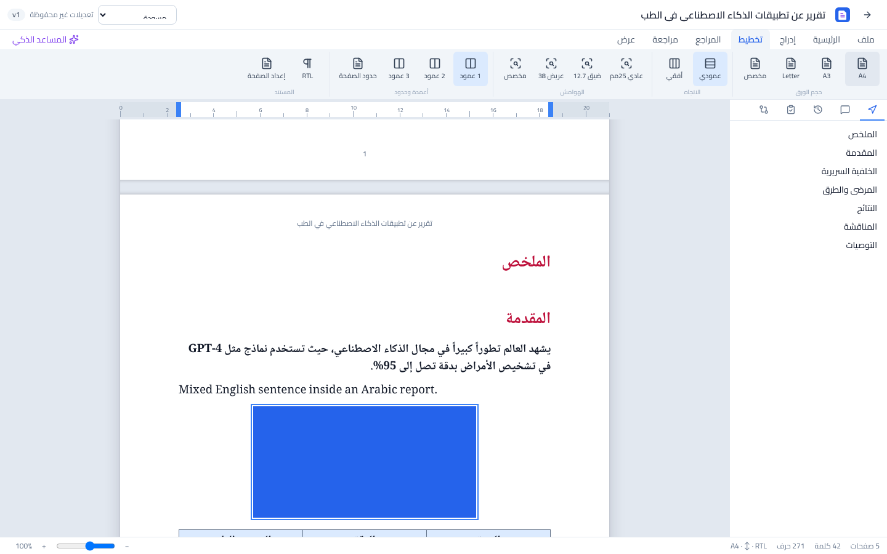

# Report Studio PRO

نظام احترافي لإنشاء وكتابة وتنسيق وإدارة التقارير بمحرر شبيه بـ Word وذكاء اصطناعي هجين (سحابي + محلي).
Professional AI-assisted report writing system: a Word-like editor with real pages, Arabic RTL support, references, templates, PDF/DOCX export and offline sync.



## Quick start (development)

Requirements: Python 3.11+, Node 20+.

```bash
cp .env.example .env            # then set RSP_JWT_SECRET / RSP_SECRETS_KEY
cd backend && pip install -r requirements.txt
python -m app.migrate           # SQLite by default; PostgreSQL if RSP_DATABASE_URL points to it
uvicorn app.main:app --reload --port 8000     # API + Swagger at http://localhost:8000/docs
```

```bash
npm install                     # from the repo root (npm workspaces)
npm run dev                     # web app at http://localhost:5173
```

Register an account in the app, then (optional) add an AI provider under **Settings → AI providers**
(OpenAI, Ollama at `http://localhost:11434`, Anthropic, or any OpenAI-compatible server).

### Production with Docker (PostgreSQL + pgvector)

```bash
cd docker && docker compose --env-file ../.env up --build
```

### Windows desktop (Tauri)

Build on Windows with Rust + the Tauri prerequisites installed:

```bash
pip install pyinstaller && npm run build:backend -w @rsp/desktop
npm run desktop:build           # produces NSIS/MSI installers in apps/desktop/src-tauri/target/release/bundle
```

The desktop app bundles the backend as a local sidecar (`127.0.0.1:8765`, SQLite in `%APPDATA%\ReportStudioPRO`),
so editing, export and local Ollama work without internet.

## Tests

```bash
cd backend && python -m pytest -q                 # 40 API/export/AI/sync/security tests (SQLite)
RSP_TEST_DATABASE_URL=postgresql+psycopg://user:pw@localhost/rsp_test python -m pytest -q   # same suite on PostgreSQL
npm test -w @rsp/web                              # 21 editor/layout/sync/template unit tests
# end-to-end (backend on :8000, `npx vite preview` on :5173):
node tests/e2e/success-criterion.e2e.mjs out && python tests/e2e/verify_exports.py out
```

The E2E test runs the whole workflow in Chromium: register → wizard → template → write Arabic/English and format → table → image → save →
close → reopen → export Word and PDF. It then checks the files' contents.

See [docs/ARCHITECTURE.md](docs/ARCHITECTURE.md) and [docs/STATUS.md](docs/STATUS.md) (what is complete and the known limitations).
